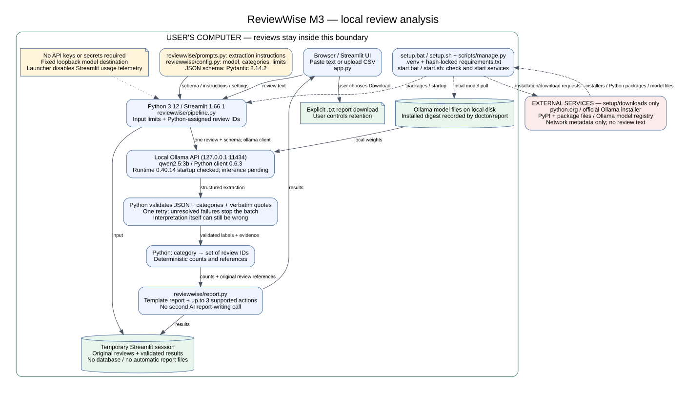

# ReviewWise AI — M3 MVP

**Status:** M3 implementation draft. Offline logic/UI tests pass on Linux;
real model inference is currently blocked by cloud registry access. Windows
installation, another person's laptop test and the demo video remain outstanding.
See [validation evidence](docs/m3_validation.md). M3 is not yet complete or submitted.

**5 November runtime correction — awaiting real-model verification:** current
source adds live partial results, cancellation, duplicate-run protection and
compact evidence IDs. **71 offline tests and fixture browser checks pass.**
This is not an AI speed or accuracy result. The Windows ZIP still contains the
previous `3569de5` package; it will be refreshed only after a real Qwen check.

## 1. What it does

ReviewWise helps café owners understand customer reviews in English, French,
German and Luxembourgish. Paste reviews or upload a CSV, analyze them locally
with Ollama and `qwen2.5:3b`, inspect complaint counts and supporting evidence,
and download a weekly report with practical actions. Choose any day in the
Monday–Sunday reporting week and supply the reviews collected during that week.
Up to **1,000 reviews per report**, including an 80-row CSV, are accepted within
the existing 1 MB file and 2,000-character-per-review limits. Every accepted row
is tracked; only validated reviews contribute to complaint counts. Failed and
pending reviews remain listed, and partial reports are labelled. The input
preview shows only the first 20.
Python performs the counting;
AI interprets the reviews. Incorrect interpretations remain possible.

## 2. Users and value proposition

For small-business owners in Luxembourg who need to understand multilingual
feedback, ReviewWise turns supplied café reviews into traceable improvement
suggestions. The current prototype focuses on cafés; hotels and restaurants
are potential later users. Business owners/managers are the potential payers.
Each report represents one business and a reporting week selected by the user.
Review dates are not verified or filtered: the supplied file must contain only
the intended week's reviews. Other CSV columns, including dates, remain ignored.

## 3. How to run it (three steps on Windows)

**Windows 11 x64 is the primary target.** Automatic prerequisite installation
uses **WinGet**, included with Windows App Installer on standard Windows 11
installations. Windows execution still needs a real laptop test; see
[the recorded evidence](docs/m3_validation.md).

1. Download the [Windows package, ReviewWise-M3-Windows.zip](https://github.com/abdai-eman/reviewwise-ai/raw/refs/heads/m3-mvp/download/ReviewWise-M3-Windows.zip).
2. Right-click it, choose **Extract All**, then open the resulting folder.
   The launcher is directly inside this folder; no inner project folder is required.
3. Double-click **`START_REVIEWWISE.bat`**. Wait for the app to open in your browser.
   Keep the launcher window open. Paste reviews or upload a CSV, then click **Find my next improvements**.

**First launch:** the launcher reuses an installed **64-bit Python 3.11-3.15**
and existing **Ollama**. If no compatible Python can be found, it asks before
installing Python 3.12; you can decline. Python launcher auto-downloads are
disabled during detection. Missing software uses the WinGet community source
and its installer checksum checks. The launcher creates `.venv`,
installs the hash-locked Python packages, starts Ollama and downloads `qwen2.5:3b`
if missing. Package/source agreements are accepted by this automatic setup.
Internet and permission to install software are needed. Installation can take
several minutes. No VS Code, terminal commands, Docker, Git, Node.js or API key
is required. The launcher handles its own working directory, including paths
with spaces, and chooses another local port if its preferred port is occupied.

Package installation now shows pip's real download/install output and writes
`.reviewwise/install.log`. A window showing only the old quiet-install message
does not prove that installation is stalled; that process still uses the older
installer code until it finishes or is stopped.

On Windows, a successful setup records its environment location under
`%LOCALAPPDATA%\ReviewWise\environment.json`. A new extracted copy can reuse it
in place when its requirement hash and 64-bit Python compatibility match. For
earlier versions without that record, the launcher checks nearby folders named
ReviewWise for a matching completed installation. It never moves a virtual
environment or edits review files. Keep the folder holding the reused environment;
if it is deleted or its requirements differ, a fresh installation is needed.

**Next time:** double-click **the same `START_REVIEWWISE.bat` file**. It reuses
the packages/model and starts services automatically. No package installation
or model download is attempted when the existing setup is current. Stop the app
with Ctrl+C in the launcher window. Ollama may remain running; quit its
application separately if you want to release its resources.
The current source reopens an already running instance of the same project
instead of starting another server. The browser can also have only one active
analysis; a second tab cannot queue another model run.

**Updating an existing copy with the redesigned interface:** stop the app first.
Download and extract the current Windows package. Copy `app.py`, `reviewwise/`,
`scripts/`, `assets/` and `.streamlit/` into your existing project folder, replacing matching files, then
double-click its `START_REVIEWWISE.bat` again. Keep your existing `.venv` and
review files. This UI update adds no dependencies and does not need a new model
download. Refresh an already open browser tab with Ctrl+F5.

**Weekly workflow and waiting time:** choose the reporting week, upload its
reviews or paste one per line, then select **Find my next improvements**.
A new report sends up to four short uncached reviews per model call; long
reviews are isolated. The model returns category and numbered evidence IDs,
and Python copies the original text. Grouped responses that fail validation are
retried as individual reviews. A repeatedly invalid review is listed as needing
attention; it does not discard successful results or prevent the remaining
reviews being processed. Connection failures/timeouts stop further requests
and retain a partial report with explicit pending reviews.
The background worker leaves the page available. Validated results appear while
the analysis continues. **Stop analysis** closes the streamed request on its
next response; a stalled read can take up to its 60-second timeout. A first run
can still take several minutes or longer on a laptop.
Actual first-run time for 80 new reviews has not been measured here.
Completed, validated extractions stay in the current session. Retrying after
a failure reuses completed work; repeating the same input reuses the matching
extractions. A model-weight, prompt, schema or generation-setting change requires
fresh extraction. Reused analyses are labelled in the screen and download.
No automatic report/cache files are written. Keep the same session open for a
class presentation; **Start over**, closing the app or restarting it can lose
the cache. Download a finished report if you need to keep it.
**Release AI memory** asks Ollama to unload this model when no analysis is
running. New uncached input will need to load it again. Request settings limit
CPU inference to at most two threads and use a 2,048-token context for short
groups (4,096 for long reviews). This reduces requested resources; it does not
establish acceptable speed or memory use on an 8 GB Windows laptop.

The professor uses File Explorer and the browser. The developer terminal commands
later in this README are not part of these setup steps. The GitHub **Code → Download ZIP**
option is still available for the source repository, but that ZIP adds an inner
`reviewwise-ai-m3-mvp` folder; the Windows package above avoids that extra level.

**Fallback when WinGet is unavailable:** first install
[64-bit Python 3.11-3.15](https://www.python.org/downloads/windows/) with pip and the
Python launcher, then [Ollama](https://ollama.com/download/windows), then follow
the three steps above. This path totals **five steps**, including both manual
prerequisite installations. An organization may need to allow software installs.
Compatible existing Python installations are reused; another version is not
required just because Python 3.12 is absent. Automated compatibility checks
cover Python 3.11-3.15; a native Windows first-run test is still needed.
The older `start.bat` delegates to the same launcher; `setup.bat` remains available
for preparation without opening the app.

**Downloads and hardware:** internet is required for the installers, ZIP, Python
packages and initial model download. The model is approximately **1.9 GB**
(estimate, not verified against the registry in this environment). Allow roughly
**10 GB free disk** and preferably **16 GB RAM**; these are planning recommendations,
not measured minimums. CPU inference is supported by Ollama but may be slow;
no dedicated GPU is required by our code. Hardware performance and offline
operation after setup still need laptop validation. See
[Ollama's hardware guidance](https://docs.ollama.com/gpu).

**macOS/Linux (manual prerequisites):** use Python 3.11-3.15 with pip/venv,
install Ollama, download/extract the project, run `bash setup.sh`, then run
`bash start.sh`. Linux Python 3.12.14 and native Ollama 0.40.14 were used for
the recorded checks. macOS and other distributions are not yet verified targets.

| Message or symptom | Action |
|---|---|
| Python or Ollama installation fails | Check internet/install permissions. If WinGet is unavailable, use the manual fallback above, then retry `START_REVIEWWISE.bat`. |
| Launcher says to extract the ZIP | Right-click the ZIP → Extract All; open the extracted folder before double-clicking the launcher. |
| Service cannot start | Open Ollama manually. Inspect `.reviewwise/ollama.log`; another program may occupy port 11434. |
| Model missing / download failed | Retry the launcher with internet and enough disk space. School/company proxies may block the registry. |
| Package installation failed | Read the pip error; check connection, disk space and Python version. Never disable TLS or checksum checks. |
| Browser does not open | Use the local address printed by Streamlit in the terminal. |
| Application port already in use | The launcher chooses an available port automatically; use the address printed in its window. |
| Analysis times out / model cannot load | Close memory-heavy applications and try one shorter review. CPU inference can take minutes. |
| Extraction cannot be validated | Current source lists the failed review and retains validated results in a clearly labelled partial report. Retry after editing it, or inspect the original evidence. |

Developer checks from the repository root (not additional professor setup steps):

```powershell
.venv\Scripts\python.exe -m unittest discover -s tests -v
.venv\Scripts\python.exe scripts\manage.py doctor
.venv\Scripts\python.exe scripts\manage.py smoke --text "The coffee was cold and we waited too long."
```

On macOS/Linux replace `.venv\Scripts\python.exe` with `.venv/bin/python`.
The smoke command calls the real model; unit/UI fixtures are not proof of AI quality.

## 4. Architecture



The browser talks to a local Streamlit process. One cancellable background
worker sends groups of up to four short reviews to local Ollama with a JSON
schema. Python validates review IDs, category labels and evidence-unit IDs,
then copies passages from the original text and checks quotation traceability.
A temporary session cache reuses
matching validated extractions and revalidates their evidence before reuse.
Python then counts distinct review IDs
per complaint. A template report presents counts, positive evidence and up to
three supported actions for the user-selected week. The date range labels the
supplied input; it does not establish when reviews were written.
Unknown complaints remain visible as “other.” No second
model call rewrites counts. Reviews and results stay in the browser/server
session; only an explicit download creates a report. No database or API secrets
are required. Package/model downloads contact external services during setup;
analysis uses a fixed loopback address. [Diagram source](docs/architecture.dot).

## 5. AI components

- **Model:** local Ollama `qwen2.5:3b`. The tag is not immutable; `doctor` prints
  its installed digest and size. The report also records the digest.
- **Runtime:** Ollama; the launcher rejects releases older than 0.5.7.
  Native runtime 0.40.14 starts here; inference compatibility is not yet verified.
- **Python packages:** Streamlit **1.66.1**, `ollama` **0.6.3**, Pydantic **2.14.2**.
  All resolved dependencies and artifact hashes are in `requirements.txt`.
- **Prompt:** [reviewwise/prompts.py](reviewwise/prompts.py).
  Category/action definitions and model limits are in
  [reviewwise/config.py](reviewwise/config.py); the schema and extraction call
  are in [reviewwise/pipeline.py](reviewwise/pipeline.py).
- **Processing:** structured classification of numbered evidence at temperature
  zero; an invalid group is isolated into individual requests. An invalid
  individual review is listed, not counted as a successful empty result.
  Python validates evidence and counts; action templates remain deterministic.
- **Data:** user-supplied reviews or the labelled fictional M2 example in
  `experiments/reviews.json`. No scraping, cloud fallback or mocked app responses.

## 6. Evaluation

The [preserved M2 experiments](experiments/README.md) recorded AI runtimes of
221.80, 60.99 and 241.57 seconds. These were individual historical runs, not M3
benchmarks. Their inaccurate counts and translations motivated the M3 design.

The M3 offline suite checks input handling, multilingual quote validation,
retries, failure messages, distinct-review counting, reporting, UI state and
cold/warm launcher behavior (including mocked Windows installer operations).
Its known-label counting test matches the M2 reference answers; it does **not**
establish that the real model extracts those labels correctly.

Real inference, manual comparison on new input, performance measurements,
offline operation and another person's laptop test remain required. Current
outcomes and the test protocol are in [docs/m3_validation.md](docs/m3_validation.md).

## 7. Limitations, risks, privacy and ethics

1. AI can misclassify or omit feedback, especially Luxembourgish. Quote validation
   checks traceability, not the correctness of interpretation.
2. Counts are exact for extracted labels, not guaranteed true complaint counts.
3. Six café categories are limited. “Other” may combine unrelated complaints;
   inspect them individually. Actions cover only recognized categories.
4. Reports accept up to 1,000 reviews of at most 2,000 characters each; CSVs
   must fit within 1 MB. CPU analysis can be slow, especially for a new 80-review
   file. Validation failures are listed in partial reports; connection failures,
   timeouts or cancellation leave explicit pending reviews. Retrying in the
   same session reuses completed validated analyses.
5. Duplicate rows count separately. Dates, business identity and authenticity
   are not verified. The reporting week is user-supplied; input dates are not
   checked or filtered. Only upload reviews for the intended week.
6. Windows installation and real M3 inference are not yet verified here.

Remove unnecessary personal details before use. Review text goes only to
`127.0.0.1:11434`; the model client ignores proxy/environment routing. There is
no database or automatic customer-report file; clear the session when finished.
Explicit downloads remain on the user's computer until deleted. Ollama/system
logs have their own retention; do not enable debug logging with personal reviews.
Setup contacts package/model providers. The launcher disables Streamlit usage
telemetry. Use permitted input, avoid publishing customer data without appropriate
rights, and keep a human responsible for decisions. Language bias needs evaluation.
Formal legal/regulatory assessment has not been completed.

## 8. Business case

Initial customers would be independent café owners/managers in Luxembourg.
M1 cited approximately 2,675 accommodation/food-service businesses in 2022
([STATEC, Luxembourg in Figures 2025, p. 48](https://statistiques.public.lu/dam-assets/catalogue-publications/luxembourg-en-chiffres/2025/luxembourg-in-figures-2025.pdf));
this is a broad sector total, not a verified café market size. The interviews
in `PROJECT_LOG.md` did not establish a willingness-to-pay amount.

A successful report of 80 distinct short uncached reviews can use 20 four-review
requests × €0 metered local API fee = **€0 metered API fees**. Longer reviews and
invalid group responses increase calls; the bounded individual fallback can
reach 160 calls in the worst case. These are request counts, not runtime estimates.
Reusing validated analyses requires no new extraction call for
those rows, but still checks the installed model identity. Electricity,
hardware and support costs remain unmeasured. Pricing and margins need customer
evidence. Alternatives include Trustpilot Business, Birdeye and manual reading;
the proposed advantage is local multilingual analysis with inspectable evidence.

## 9. AI tools the team used

M2 used ChatGPT for coding/prompt assistance and local Qwen2.5 for the recorded
experiments. OpenAI Codex assisted with M3 code, tests and documentation in this
workspace. The team must review, test and understand it before submission;
AI assistance does not establish an individual student's contribution.

## 10. Who did what

Team: MAKNI Abdourrahmane, HAFT Benjamin, ABDAI Eman.
The M2 plan assigned analysis/counting to Abdourrahmane, interface work to
Benjamin and multilingual testing to Eman, with shared integration/demo work.
**Actual contributions since M2 have not yet been confirmed.** Replace this
with two factual lines backed by each member's work before submission.

M3 preparation: [summary draft](docs/m3_summary.md) and [demo/submission checklist](docs/m3_submission.md).
No M3 tag, video link or claim of another-laptop validation has been created.
