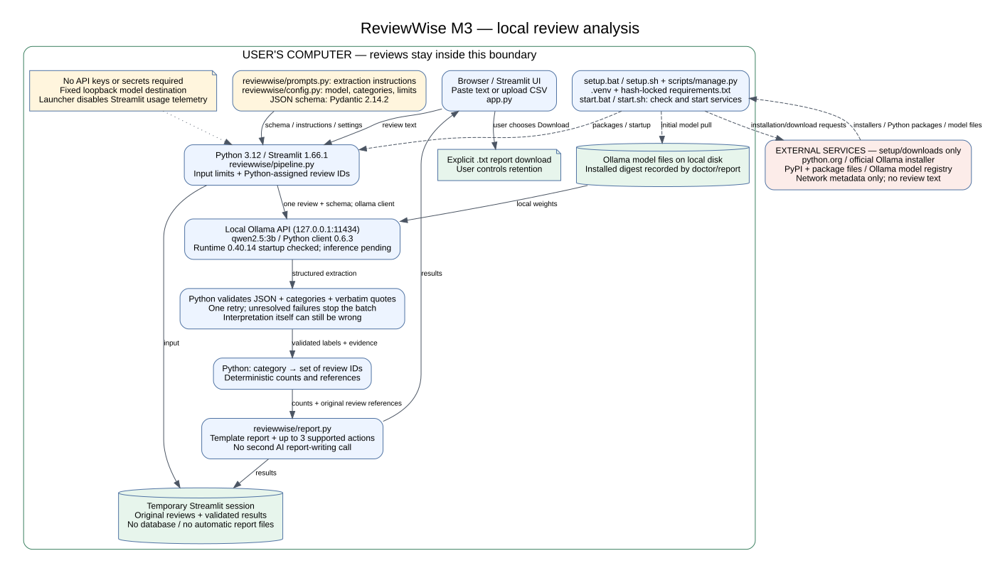

# ReviewWise AI

**AI-Powered Multilingual Customer Review Analysis for Small Businesses in Luxembourg**

## 1. What it does

ReviewWise helps small businesses in Luxembourg make better use of customer reviews in French, German, Luxembourgish, and English. Users paste reviews or upload a CSV. The app groups recurring complaints, shows positive feedback and original supporting passages, and suggests practical improvements.

**Our main question:** What should this business improve this week?

## 2. Users and value proposition

**Target users:** Owners and managers of small businesses in Luxembourg, particularly independent cafés, restaurants, and hotels. The M3 prototype focuses on cafés.

**Potential customers:** Small businesses that regularly review customer feedback.

**Value proposition:** ReviewWise helps owners understand multilingual feedback and identify practical improvements based on recurring complaints. Each business receives an analysis based on the reviews it supplies.

## 3. How to run it

### M3 — Windows setup

1. [Download the Windows package](https://github.com/abdai-eman/reviewwise-ai/raw/refs/heads/main/download/ReviewWise-M3-Windows.zip).
2. Right-click the ZIP, choose **Extract All**, and open the extracted folder.
3. Double-click **`START_REVIEWWISE.bat`** and keep its window open. ReviewWise opens in your browser.

The Windows package includes Python and the app dependencies. On first launch, internet access is needed if the launcher has to install Ollama or download the `qwen2.5:3b` model. Wait for local AI setup to finish before running an analysis. If WinGet is unavailable, [install Ollama for Windows](https://ollama.com/download/windows) first, then follow the three steps above.

### Try the test CSV

1. Open [Workbook1.csv](examples/Workbook1.csv) and click **Download raw file** on GitHub, or [download it directly](https://github.com/abdai-eman/reviewwise-ai/raw/refs/heads/main/examples/Workbook1.csv).
2. In ReviewWise, open **Analyse reviews**, select a reporting week, and upload the CSV.
3. Click **Find my next improvements** to analyse the 50 reviews.
4. Open **Review evidence** to see the original passages behind the findings.

You can also paste one review per line or upload your own UTF-8 CSV with a `review` column.

### M3 demo

The video was recorded from the running application. [Watch the ReviewWise demo on YouTube](https://www.youtube.com/watch?v=BEC7LJjvb2o).

### M4 — Run the evaluation

With Ollama running and the environment set up (`setup.sh` or `setup.bat`), run this from the repository root:

```bash
.venv/bin/python evaluation/run_eval.py --system model --label my-run
```

On Windows, use `.venv\Scripts\python`. The scores are written to `evaluation/results/my-run.json`. See [evaluation/README.md](evaluation/README.md) for all options.

## 4. Architecture



The Streamlit interface passes reviews to a background worker, which calls Ollama on the same computer. Qwen returns complaint categories and references to passages containing complaints or praise. Python validates those references, counts distinct reviews per complaint category, and builds the report. A temporary session cache can reuse validated results. Users can save reports locally or export them. Review text stays on the computer during analysis. Initial setup contacts external services to download software and model files. Local inference requires no API key.

## 5. AI components

In M2, we tested local Qwen2.5 3B on fictional multilingual reviews. The scripts, prompts, and outputs are preserved in the [M2 experiments](experiments/README.md).

In M3, the app uses **Qwen2.5 3B (`qwen2.5:3b`)** through the local Ollama API. The repository contains the [extraction prompt](reviewwise/prompts.py), [model and category configuration](reviewwise/config.py), and [analysis pipeline](reviewwise/pipeline.py).

Fresh review analysis calls the actual model to identify complaints and positive feedback. Python checks the returned evidence references against the supplied reviews and counts each review once per complaint category. The report shows the counts alongside the original passages. Suggested actions use fixed templates tied to the extracted categories. A saved report can be reopened without another model call.

In M4, we evaluated the model on 70 labelled reviews and made five changes based on the results. The app now sends one review per model request, splits review text on "and" as well as "but", and the [prompt](reviewwise/prompts.py) gives clearer category rules with French, German and Luxembourgish hint words. The model itself is unchanged.

## 6. Evaluation

Team members tested ReviewWise on each other's laptops and encountered no issues during those tests.

**M3 real-input test:** ReviewWise analyses real customer reviews with the local model and displays the resulting report in the [demo video](https://www.youtube.com/watch?v=BEC7LJjvb2o).

Windows CI separately verified the full path from fresh fictional input through the actual local model to the report shown in the app. It also passed 79 automated tests and verified the Windows package and launcher. [View the Windows CI run](https://github.com/abdai-eman/reviewwise-ai/actions/runs/42397705242).

**M4 evaluation:** We ran 70 fictional reviews in English, French, German and Luxembourgish against hand-written complaint labels. These are the 50 reviews in Workbook1 plus 20 harder ones. The main metric is F1 over (review, category) pairs. The baseline is a keyword matcher with no AI.

| Version | F1 | Precision | Recall | Worst request |
|---|---|---|---|---|
| Keyword baseline | 0.86 | 94% | 79% | — |
| M3 model (before) | 0.71 | 74% | 68% | 1.36 s |
| After five fixes | 0.83 | 88% | 79% | 0.48 s |

After the fixes, the model beats the baseline in English (F1 0.95 vs 0.70) and French (1.00 vs 0.93), but not in German (0.84 vs 0.95) or Luxembourgish (0.50 vs 0.88). Luxembourgish reviews it does not understand are often labelled "cold coffee". The method, data, failure cases and each fix are in [evaluation/README.md](evaluation/README.md).

## 7. Limitations, risks, privacy and ethics

1. The model can miss or misclassify complaints and praise. Users should check the original passages before acting on a finding.
2. Local analysis can be slow on laptops with limited memory.
3. The “Other” category can group unrelated complaints.
4. The reporting week is selected by the user. The app does not verify or filter review dates.
5. **Found in M4:** Luxembourgish accuracy is low (F1 0.50 in our evaluation), so findings from Luxembourgish reviews need extra checking.

Reviews are processed locally. Saved reports contain original review text. Use reviews you have permission to process and remove unnecessary personal information before sharing a CSV or report.

## 8. Business case

Our early customer research focused on small hospitality businesses in Luxembourg. The café supervisor we interviewed was interested in practical improvement suggestions. The hotel receptionist reported spending less than 30 minutes per week handling reviews and saw more potential value for larger hotels.

Local inference has no metered API fee. Pricing and willingness to pay remain open, and hardware and electricity costs have not been measured. The M1 interviews and M2 cost estimate are in the [project log](PROJECT_LOG.md).

In M4, the approach stayed local, so there is still no API fee. Analysis takes about 0.3 s per review on an Apple M5 Pro laptop.

## 9. AI tools the team used

- **M1:** Grammarly helped with grammar and wording.
- **M2:** ChatGPT assisted with code and prompts, and Qwen2.5 3B was used in the experiments.
- **M3:** Codex assisted with implementation, automated tests, and documentation.
- **M4:** Claude Code assisted evaluation script set up, implemented the five fixes, and documentation.

## 10. Who did what

### Contributions since M2

- **MAKNI Abdourrahmane:** Reviewed the full project, tested the application, and created the demo video.
- **HAFT Benjamin:** Contributed to application development and helped write the README.
- **ABDAI Eman:** Developed ReviewWise with Codex assistance and worked on the M3 summary PDF and project log.

### M4 contributions

- **MAKNI Abdourrahmane:** Evaluated and hand-wrote the expected labels for the test cases, and inspected the evaluation results for each M4 fix.
- **HAFT Benjamin:** Contributed to application development, helped write the README, ran the evaluation iteration fixes.
- **ABDAI Eman:** Evaluated and hand-wrote the expected labels for the test cases, and inspected the evaluation results for each M4 fix.
